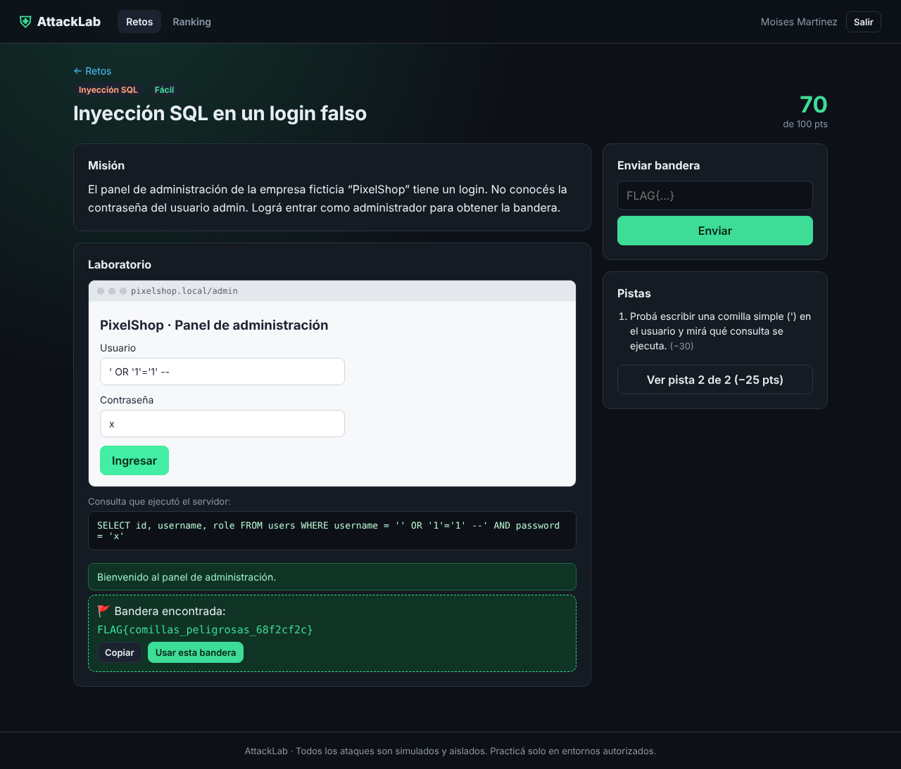
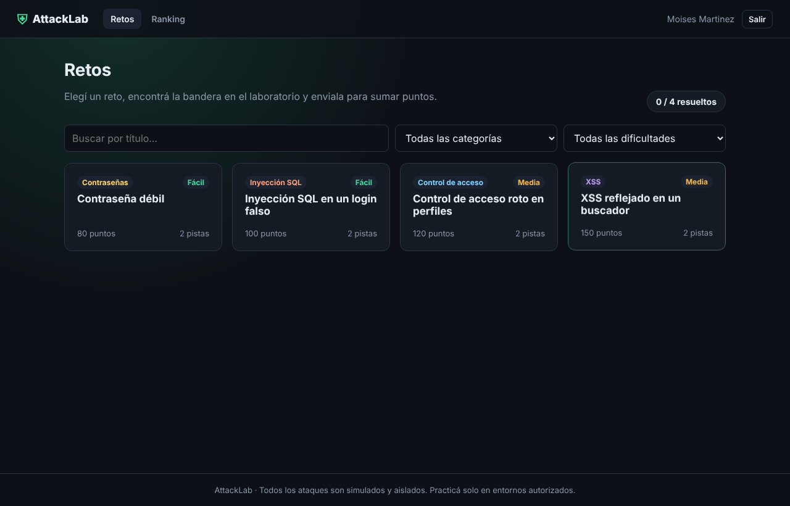
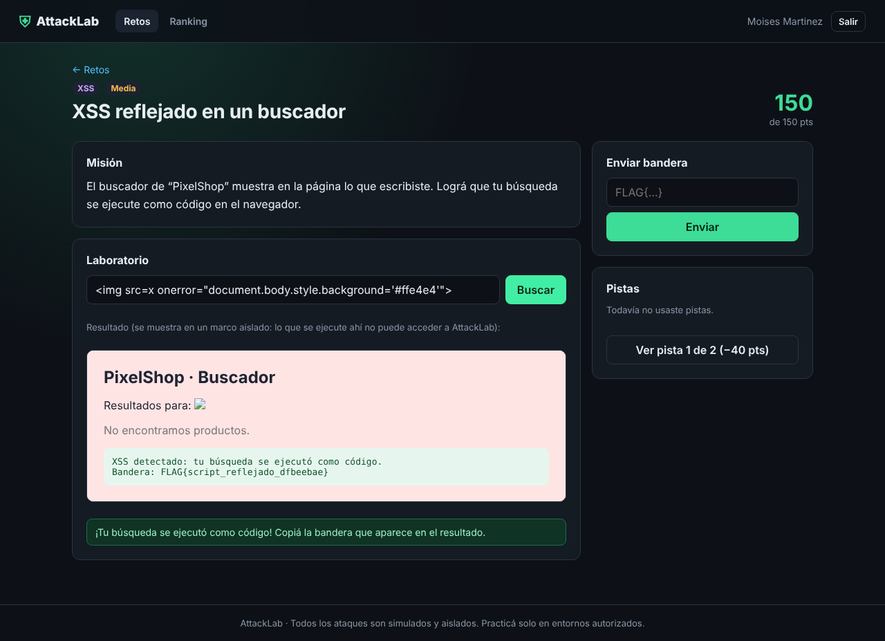
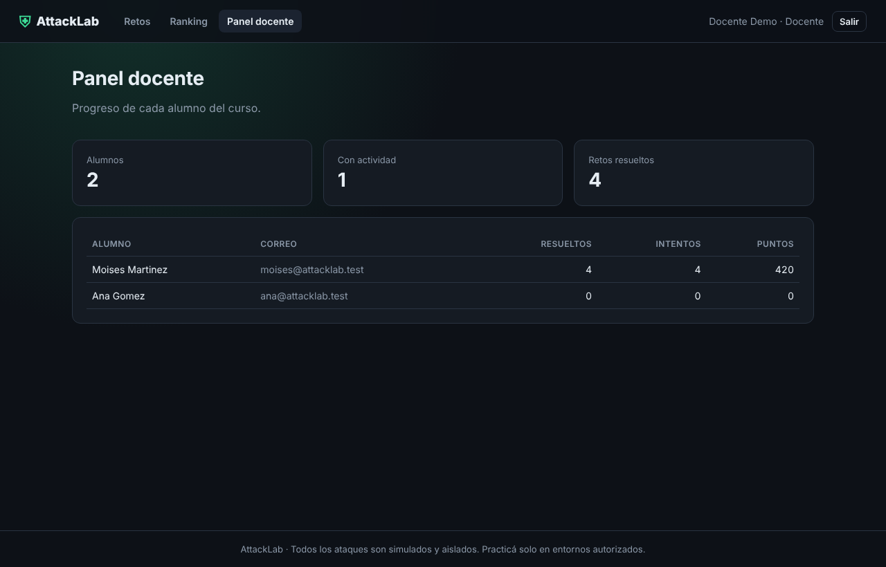

# 🛡️ AttackLab — Simulador de Ataques para Aprendizaje

**AttackLab** es un laboratorio web para que estudiantes de escuelas técnicas practiquen seguridad informática **de forma legal, guiada y medible**. Cada reto es una aplicación vulnerable *simulada y aislada*: el alumno la ataca, obtiene una bandera (`FLAG{...}`), suma puntos y, al terminar, aprende **cómo se corrige** la vulnerabilidad.

> Trabajo final de GeneraciónT · Moises Alexander Martinez Perez · E.T. N.º 20 D.E. 20 “Carolina Muzilli” · 6.º 4.ª



## Funcionalidades

- **Registro e inicio de sesión** con roles de alumno y docente. Los alumnos se registran con un código de curso.
- **Catálogo de retos** con búsqueda y filtros por categoría y dificultad.
- **4 laboratorios vulnerables simulados:**
  | Reto | Categoría | Qué se practica |
  | --- | --- | --- |
  | Inyección SQL en un login falso | Inyección SQL | Romper una consulta armada con texto |
  | XSS reflejado en un buscador | XSS | Hacer que una búsqueda se ejecute como código |
  | Contraseña débil | Contraseñas | Ataque de diccionario contra una cuenta |
  | Control de acceso roto en perfiles | Control de acceso (IDOR) | Leer datos ajenos cambiando un id |
- **Pistas progresivas** que restan puntos. El servidor lleva la cuenta: el cliente no puede mentir.
- **Explicación defensiva** al resolver cada reto.
- **Ranking del curso** y **panel docente** con el progreso de cada alumno.

| Catálogo | XSS en marco aislado | Panel docente |
| --- | --- | --- |
|  |  |  |

## Tecnologías

- **TypeScript** en modo estricto, en todo el proyecto.
- **Backend:** Node.js + Express, con arquitectura en capas (routes → controllers → services → repositories).
- **Base de datos:** SQLite con el módulo nativo `node:sqlite` y consultas parametrizadas.
- **Frontend:** React 18 + Vite.
- **Tests:** Vitest (unitarios y de integración contra la API real).
- **CI:** GitHub Actions (verificación de tipos, tests y build en cada push).

## Requisitos

- **Node.js 22.13 o superior** (necesario para `node:sqlite`). Verificalo con `node -v`.

## Instalación y uso

```bash
git clone https://github.com/moisesescuela20de20/attacklab.git
cd attacklab
npm install
```

**Modo producción** (un solo servidor con la API y la web):

```bash
npm run build
npm start          # http://127.0.0.1:3000
```

**Modo desarrollo** (con recarga automática), en dos terminales:

```bash
npm run dev:api    # API en http://127.0.0.1:3000
npm run dev:web    # Web en http://localhost:5173
```

### Usuarios de demostración

Se crean solos la primera vez (solo en desarrollo):

| Rol | Correo | Contraseña |
| --- | --- | --- |
| Alumno | `moises@attacklab.test` | `Alumno#2026` |
| Alumna | `ana@attacklab.test` | `Alumna#2026` |
| Docente | `docente@attacklab.test` | `Docente#2026` |

Código de curso para registrarse: **`ET20-6-4`** (configurable).

### Variables de entorno

Ver [`.env.example`](.env.example). Las principales:

| Variable | Por defecto | Para qué sirve |
| --- | --- | --- |
| `PORT` | `3000` | Puerto del servidor |
| `HOST` | `127.0.0.1` | Solo esta computadora. `0.0.0.0` lo abre a la red del aula |
| `ATTACKLAB_DB` | `data/attacklab.db` | Archivo de la base de datos |
| `ATTACKLAB_COURSE_CODE` | `ET20-6-4` | Código para registrarse |
| `ATTACKLAB_DEMO_USERS` | `true` en desarrollo, `false` en producción | Crea los usuarios demo |
| `ATTACKLAB_TEACHER_EMAIL` / `_PASSWORD` / `_NAME` | — | Docente inicial para producción |

## Tests

```bash
npm test           # 50 tests
npm run typecheck  # TypeScript estricto
```

Cubren el puntaje, la autenticación (incluido el bloqueo tras 5 intentos fallidos), el registro, los permisos del panel docente, los cuatro laboratorios y el flujo completo de punta a punta. También verifican que **una inyección SQL en el laboratorio no puede tocar la base real** y que **una consulta infinita se corta sin colgar el servidor**.

## Seguridad: cómo se aísla lo vulnerable

AttackLab es vulnerable **a propósito** en los laboratorios, y por eso el resto del sistema se diseñó con especial cuidado. El detalle está en [`docs/SEGURIDAD.md`](docs/SEGURIDAD.md); en resumen:

- **Inyección SQL:** la consulta vulnerable se ejecuta en un **hilo separado**, sobre una base en memoria descartable con datos ficticios, con **300 ms** de tiempo máximo y memoria limitada.
- **XSS:** el resultado se muestra en un `iframe` con `sandbox="allow-scripts"`, sin `allow-same-origin`. Lo que se ejecute ahí no puede leer la sesión ni la página de AttackLab.
- **Banderas:** no están escritas en el código. Se derivan de un secreto aleatorio propio de cada instalación y se guardan como hash.
- **Sistema propio:** contraseñas con `scrypt` asíncrono y sal, comparación en tiempo constante, bloqueo tras 5 intentos fallidos, tiempo de respuesta igual exista o no el correo, sesiones que vencen y límites de pedidos.

## Estructura

```
attacklab/
├── src/
│   ├── challenges/        Lógica de puntaje (scoring.ts) y tipos
│   └── server/
│       ├── app.ts         Arma la aplicación Express
│       ├── server.ts      Punto de entrada
│       ├── routes/        URL → controller
│       ├── controllers/   HTTP ↔ services
│       ├── services/      Reglas de negocio (auth, retos, contraseñas, límites)
│       ├── repositories/  Acceso a SQLite (consultas parametrizadas)
│       ├── labs/          Laboratorios vulnerables simulados + sandbox SQL
│       ├── middlewares/   Autenticación, roles, errores, encabezados
│       └── db/            Esquema, datos iniciales y retos
├── web/                   Frontend React + Vite
├── tests/                 Vitest
├── docs/                  Seguridad, soluciones, capturas y material del curso
├── SPEC.md · AGENTS.md    Especificación y reglas para agentes de IA
└── .github/workflows/     Integración continua
```

## API

| Método | Ruta | Descripción |
| --- | --- | --- |
| POST | `/api/auth/register` | Crear cuenta de alumno (requiere código de curso) |
| POST | `/api/auth/login` · `/api/auth/logout` | Iniciar y cerrar sesión |
| GET | `/api/auth/me` | Usuario actual |
| GET | `/api/challenges` | Listado de retos (sin banderas) |
| GET | `/api/challenges/:id` | Detalle: misión, pistas desbloqueadas, explicación |
| POST | `/api/challenges/:id/hints` | Desbloquear la siguiente pista |
| POST | `/api/challenges/:id/submissions` | Enviar una bandera |
| GET | `/api/ranking` | Ranking del curso |
| GET | `/api/teacher/progress` | Progreso de los alumnos (solo docente) |
| POST/GET | `/api/labs/...` | Laboratorios vulnerables simulados |

Las rutas protegidas usan `Authorization: Bearer <token>`.

## Documentación

- [`SPEC.md`](SPEC.md): especificación del proyecto.
- [`AGENTS.md`](AGENTS.md): reglas para trabajar con agentes de IA.
- [`docs/SEGURIDAD.md`](docs/SEGURIDAD.md): decisiones de seguridad.
- [`docs/SOLUCIONES.md`](docs/SOLUCIONES.md): soluciones de los retos, para el docente (**spoilers**).

## Aviso

AttackLab es una herramienta educativa. Las técnicas que enseña se practican **solo** dentro de sus laboratorios simulados. Usarlas contra sistemas sin autorización es ilegal.

## Licencia

[MIT](LICENSE) © 2026 Moises Alexander Martinez Perez
